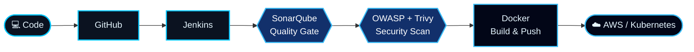

<div align="center">


<br/>


<br/><br/>

<a href="https://www.linkedin.com/in/suchith-k-0262a5252/"></a>
<a href="mailto:suchith004@gmail.com"></a>
<a href="https://github.com/Suchith-K-git"></a>


</div>


<div align="center">

</div>

<table>
<tr>
<td width="58%" valign="top">

### Hello, I'm Suchith 👋

DevOps Engineer based in Bengaluru, India, with close to **2 years of hands-on experience** in cloud infrastructure, automation, CI/CD, and containerization.

I build reliable deployment workflows, automate repetitive tasks, and improve software delivery through DevOps and DevSecOps practices.

- ☁️ Cloud infrastructure on **AWS**
- 🧱 Infrastructure as Code with **Terraform**
- 🔄 CI/CD automation with **Jenkins**
- 📦 Containerization with **Docker**
- ☸️ Orchestration with **Kubernetes**
- 🛡️ Security scanning with **SonarQube** and **Trivy**

</td>
<td width="42%" valign="top">

```bash
$ whoami
suchith-k

$ cat profile.yml
role:       DevOps Engineer
location:   Bengaluru, India
experience: ~2 years
core:       [AWS, Terraform, Jenkins,
             Docker, Kubernetes]
focus:      [Automation, CI/CD,
             DevSecOps]

$ echo $STATUS
open_to_opportunities
```

</td>
</tr>
</table>

> [!TIP]
> **Open to opportunities** in DevOps, Cloud, and DevSecOps roles, and happy to collaborate on open-source and cloud projects. **Currently exploring:** GitOps, observability, and cloud-native tooling.


<div align="center">

</div>

<div align="center">



</div>


<div align="center">

</div>

<div align="center">


<br/><br/>

| | Domain | Tools |
|:---:|:---|:---|
| ☁️ | **Cloud & Infrastructure** | AWS (EC2, S3, CloudFront, Route 53, EKS), Terraform, Linux, Bash |
| 📦 | **Containers & Orchestration** | Docker, Kubernetes, Helm, MetalLB |
| 🔄 | **CI/CD & Version Control** | Jenkins, Git, GitHub, GitHub Actions |
| 🛡️ | **DevSecOps** | SonarQube, Trivy, OWASP Dependency-Check |
| 📊 | **Monitoring & Automation** | Prometheus, Grafana, Ansible |

</div>


<div align="center">

</div>

<table>
<tr>
<td width="50%" valign="top">

### 🔐 DevSecOps Pipeline

Automated delivery workflow with integrated quality checks and vulnerability scanning.

**Highlights**
- Jenkins pipeline automation
- SonarQube static analysis
- Trivy image scanning
- OWASP dependency checks


</td>
<td width="50%" valign="top">

### ☁️ AWS Cloud Deployment

Deploying a full-stack application on AWS EC2 with a container-based workflow.

**Highlights**
- AWS environment setup
- Docker application packaging
- Jenkins CI/CD integration
- Code quality and security checks


</td>
</tr>
<tr>
<td width="50%" valign="top">

### ☸️ Kubernetes Platform

Practicing application deployment and networking across Kubernetes clusters.

**Highlights**
- Ingress and TLS
- Horizontal Pod Autoscaling
- Helm deployments
- LoadBalancer networking with MetalLB


</td>
<td width="50%" valign="top">

### 🌐 AWS Static Website Hosting

Static website deployment using AWS content delivery and DNS services.

**Highlights**
- S3 website assets
- CloudFront distribution
- Custom-domain DNS configuration
- HTTPS certificate setup and cache invalidation


</td>
</tr>
</table>

<div align="center">

<a href="https://github.com/Suchith-K-git?tab=repositories"></a>

</div>


<div align="center">

</div>

<div align="center">

<a href="https://github.com/ryo-ma/github-profile-trophy">

</a>

</div>


<div align="center">

</div>

<div align="center">

<a href="https://github.com/Suchith-K-git">

</a>
<a href="https://github.com/Suchith-K-git">

</a>

<br/><br/>


</div>


<div align="center">

</div>

<div align="center">


</div>


<div align="center">

</div>

<div align="center">

<picture>
  <source media="(prefers-color-scheme: dark)" srcset="https://raw.githubusercontent.com/Suchith-K-git/Suchith-K-git/output/github-contribution-grid-snake-dark.svg"/>
  <source media="(prefers-color-scheme: light)" srcset="https://raw.githubusercontent.com/Suchith-K-git/Suchith-K-git/output/github-contribution-grid-snake.svg"/>
  
</picture>

</div>


<div align="center">

</div>

<div align="center">


</div>


<div align="center">

</div>

<div align="center">

**Interested in cloud infrastructure, automation, and reliable software delivery? Let's connect.**

<br/>

<a href="https://www.linkedin.com/in/suchith-k-0262a5252/"></a>
<a href="mailto:suchith004@gmail.com"></a>
<a href="https://github.com/Suchith-K-git"></a>

<br/><br/>


</div>
